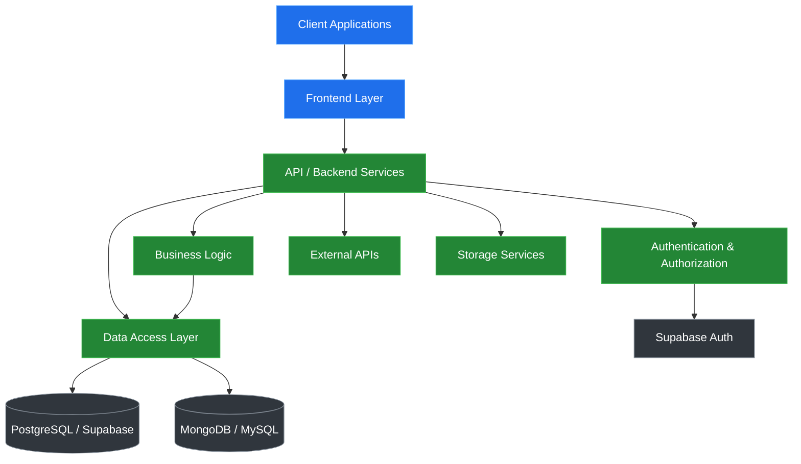
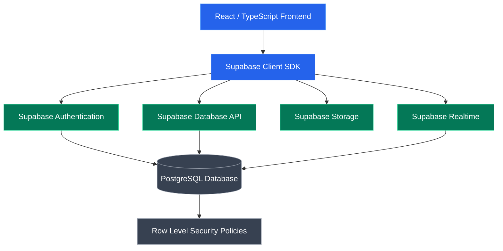
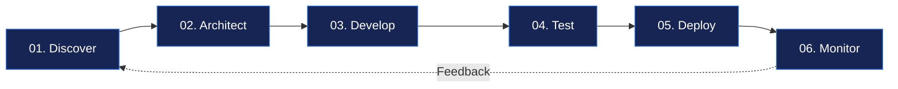

# Hi, I'm Jerry Myron

### Full-Stack Software Engineer | Software Architecture | Scalable Web Solutions

**Engineering reliable software, architecting scalable systems, and building digital products that solve real-world problems.**

 

---

## About Me

I'm **Jerry Myron**, a Full-Stack Software Engineer passionate about building modern, maintainable, secure, and scalable software solutions.

I work across the software development lifecycle, from understanding business requirements and designing system architecture to implementing frontend interfaces, backend services, databases, and deployment workflows.

My focus is on engineering solutions that combine technical excellence with practical business value.

- **Full-Stack Engineering:** Building complete applications across frontend and backend technologies.
- **Software Architecture:** Designing modular, scalable, and maintainable application systems.
- **Backend Development:** Developing RESTful APIs, authentication systems, and application services.
- **Database Engineering:** Designing relational and NoSQL data models for efficient data management.
- **Cloud & Deployment:** Working with cloud-backed applications, containerization, and deployment workflows.
- **Problem Solving:** Transforming complex requirements into reliable software solutions.

> "Great software is not just about writing code. It is about designing systems that solve the right problems efficiently, reliably, and at scale."

---

## Technical Expertise

### Programming Languages

### Frontend Engineering

### Backend Engineering

### Databases, Backend Platforms & Cloud

### Developer Tools & Workflow

---

## Technology Stack at a Glance

---

## Software Architecture

I approach software development with a strong emphasis on separation of concerns, maintainability, performance, and scalability.

The following diagram illustrates a typical full-stack architecture that guides my engineering decisions.

**Architecture priorities:**

- Modular application structure
- Secure authentication and authorization
- Clear API contracts
- Efficient database design
- Reusable business logic
- Maintainable and testable code
- Reliable deployment workflows

---

## Supabase & Modern Backend Development

I use modern backend technologies to design data-driven applications with authentication, database management, and cloud-backed services.

### Supabase Ecosystem

### Example Supabase Application Architecture

**Engineering considerations:**

- Authentication and session management
- PostgreSQL schema design
- Row Level Security (RLS)
- Database queries and relationships
- File storage and access policies
- Realtime data synchronization
- Secure integration with frontend applications

---

## Engineering Workflow

My development process follows a structured software engineering lifecycle.

| Phase | Engineering Focus |
|:---|:---|
| **Discovery** | Requirements analysis, business objectives, technical constraints |
| **Architecture** | System design, database schemas, API contracts |
| **Development** | Frontend, backend, integrations, modular implementation |
| **Testing** | Functional validation, debugging, code review |
| **Deployment** | Release management, environment configuration |
| **Maintenance** | Monitoring, performance optimization, continuous improvement |

---

### Contribution Streak

---

## Engineering Principles

| Principle | My Approach |
|:---|:---|
| **Scalability** | Design applications to support evolving requirements and growing workloads |
| **Maintainability** | Build modular systems with readable and reusable code |
| **Security** | Apply authentication, authorization, and secure data handling |
| **Performance** | Optimize database access, application logic, and frontend delivery |
| **Reliability** | Test functionality and design for predictable application behavior |
| **User Experience** | Create accessible, intuitive, and responsive interfaces |

---

## Professional Interests

My engineering interests include:

- Full-Stack Software Engineering
- Software Architecture and System Design
- Backend Engineering and API Development
- Cloud-Backed Web Applications
- Database Design and Optimization
- Developer Experience and Engineering Productivity
- Scalable Business Software Solutions

---

## Let's Build Something Meaningful

I'm interested in collaborating with engineering teams, startups, technology companies, and businesses building impactful digital products.

Whether the challenge involves designing a new platform, developing a full-stack application, modernizing an existing system, or solving a complex technical problem, I value thoughtful engineering and effective collaboration.

### Open to Software Engineering Opportunities & Collaboration

 

**Engineering solutions with purpose, precision, and scalability.**

**Jerry Myron | Full-Stack Software Engineer**

